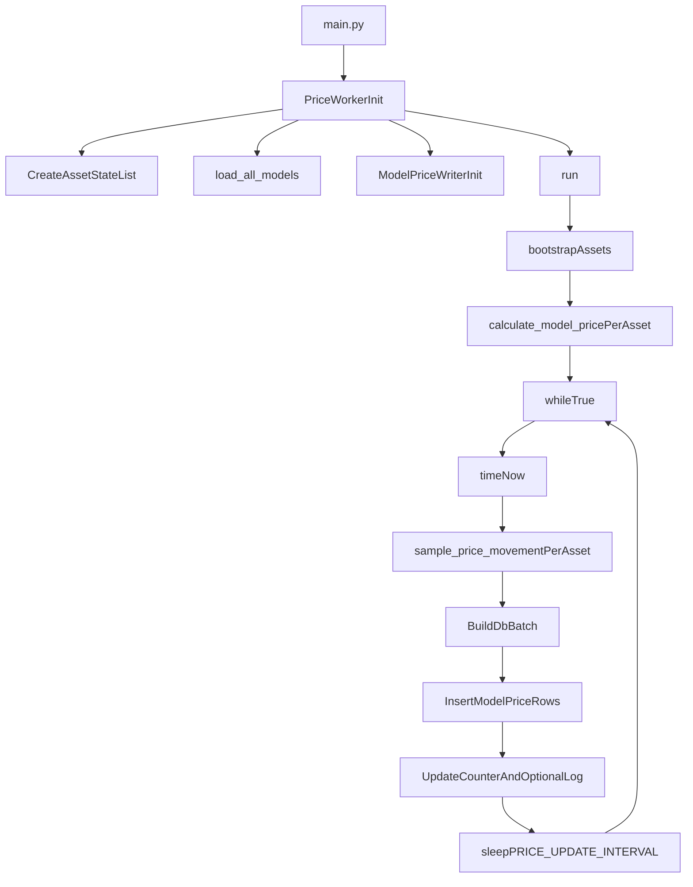
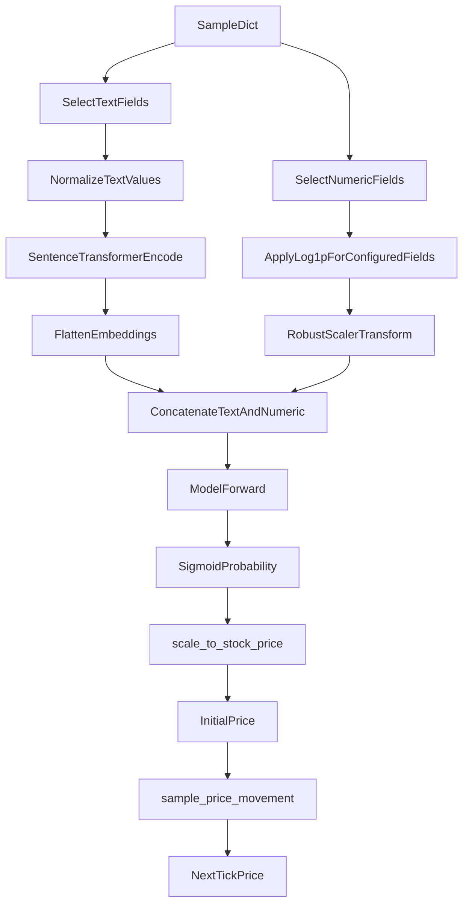

# Backend Inference Flow

This document explains how the current `backend/` runtime predicts and streams asset prices.

## Decision Questionnaire

What write-path should worker ingestion use?

- [x] Direct Python DB writes to SQLite `model_price`.
- [ ] Local HTTP bridge stores latest worker batch; Next server action pulls from it and applies typed DB writes.
- [ ] Public HTTP API ingestion

## 1) Entry Point and Runtime Loop

`backend/main.py` is the bootstrap:

1. Loads root `.env` so the worker shares `DATABASE_URL` with Next and Drizzle.
2. Constructs `PriceWorker()` with default assets source `assets/live/*.json`.
3. Calls `worker.run()`.

Inside `PriceWorker.__init__` (`backend/worker.py`):

- Builds one `AssetState` per sample (`asset_id`, original sample payload, name, `current_price`).
- Loads ML dependencies once at startup:
  - power model (`Model`)
  - numeric scaler (`RobustScaler`)
  - text embedding model (`SentenceTransformer`)
- Sets up SQLite persistence:
  - opens `DATABASE_URL` from root `.env`
  - enables WAL mode for concurrent Next reads

Inside `PriceWorker.run()`:

- Every tick reads `assets/live/*.json` and refreshes asset runtime state.
- Computes model-derived prices on each tick via `calculate_model_price(...)`.
- Enters an infinite loop (`while True`) that runs every `PRICE_UPDATE_INTERVAL` seconds (default `1.0`):
  - Captures a shared tick timestamp.
  - Builds a batch payload for storage:
    - `assetTicker` (from `assetId` field in JSON, normalized lowercase)
    - `priceCents` (`int(current_price * 100)`)
    - `timestamp`
  - Writes the batch directly to SQLite `model_price`, resolving ticker -> asset -> market.
  - Logs skipped rows for unknown tickers.
  - Logs every 10 updates.
  - Sleeps for the configured interval.

## 2) Input Data and Feature Construction

Input examples live in `assets/*.json` (one file per asset). Each sample contains:

- Identity/text-like fields: `name`, `occupation`, `citizenship`, `associations`
- Numeric fields: `net_worth`, `social_media_followers`, `age`
- Routing/metadata field used by worker: `assetId`

Field groups are formalized in `backend/types_.py`:

- `InputData.TEXT_FIELDS = ["name", "occupation", "citizenship", "associations"]`
- `InputData.NUMERIC_FIELDS = ["net_worth", "social_media_followers", "age"]`
- `InputData.LOG_TRANSFORM_FIELDS = ["net_worth", "social_media_followers"]`

In `predict_single_sample(...)` (`backend/ml/price.py`):

1. Text fields are normalized to strings (lists joined by `", "`).
2. Text strings are embedded with `SentenceTransformer.encode(...)`.
3. Embeddings are flattened into one text feature vector.
4. Numeric values are read, with log transform on selected fields (`log1p`).
5. Numeric vector is scaled by pretrained `RobustScaler`.
6. Text + numeric vectors are concatenated and passed to `Model.__call__`.
7. Model output is converted to probability via `sigmoid`.

`calculate_model_price(...)` then maps that probability to a stock-like price using `scale_to_stock_price(...)`.

## 3) Model and Dependency Loading

`backend/ml/loader.py` performs one-time startup loading:

- `load_power_model()`:
  - Opens safetensors checkpoint from `POWER_MODEL`.
  - Reads serialized model config from metadata.
  - Reconstructs model architecture (`Model(config, rngs=nnx.Rngs(0))`).
  - Restores model tensor state.
  - Rebuilds `RobustScaler` from saved center/scale arrays.
- `load_embedding_model()`:
  - Loads `SentenceTransformer` from `EMBEDDING_MODEL`.
- `load_all_models()` returns `(power_model, scaler, embedding_model)`.

Model paths and loop interval are configured in `backend/constants.py` via environment variables:

- `EMBEDDING_MODEL` (default `models/gte-base`)
- `POWER_MODEL` (default safetensors checkpoint path)
- `PRICE_UPDATE_INTERVAL` (default `1.0` seconds)
- `DATABASE_URL` (required from root `.env`)

## 4) Output Stream Contract

On each tick, worker emits one record per asset to DB write batch:

- `assetTicker: str` (lowercase ticker; resolved through server-side ports)
- `priceCents: int`
- `timestamp: float` (epoch seconds)

The worker persistence interface is:

- `backend.persistence.model_price.ModelPriceWriter`
- `INSERT INTO model_price (market_id, price, created_at)`
- `price` is stored as UTF-8 decimal bytes matching the TypeScript `scaledBigintBlob` encoding.

## 5) Runtime Characteristics

- Initial prices are ML-derived once at startup.
- Worker runs full model inference each second from current `assets/*.json` contents.
- All assets in one loop share the same tick timestamp.
- Worker runs continuously until interrupted (`KeyboardInterrupt`).

## 6) Runtime boot sequence

- Ensure root `.env` contains `DATABASE_URL`.
- Run migrations/imports (`bun db:migrate`, `bun assets:import`) before the worker writes.
- Start Next server (`npm run dev`).
- Start worker (`uv run bratva-worker`).
- Worker reads `assets/live/*.json` each tick and writes model prices directly to SQLite.

