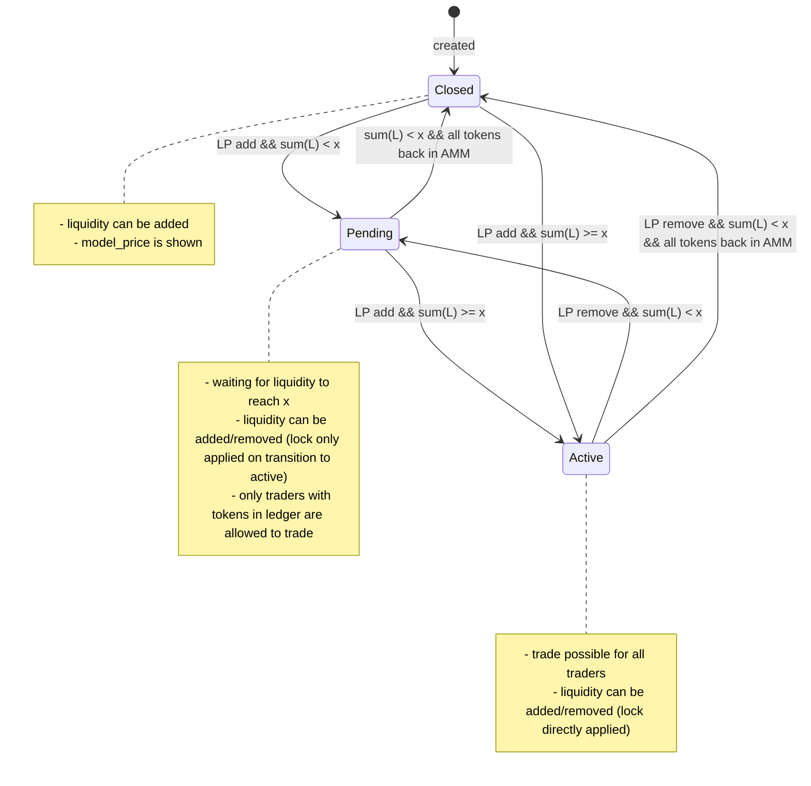

## Market lifecycle overview

The `Market` aggregate represents a tradable prediction/asset pair with an AMM pool. Its lifecycle is modeled as a state machine over three states (Closed, Pending, Active) and an AMM invariant \(x \cdot y = k\).

## State machine

## Price source policy by state

- `closed`: use `markets.modelPrice` (model price from backend worker ingestion route).
- `pending` and `active`: use AMM-derived price (`ammReserveQuote / ammReserveBase`).

This creates two write routes with explicit precedence:

- **Backend route** updates `markets.modelPrice` continuously from model inference.
- **Domain route** updates AMM reserves during liquidity/order workflows; this derived AMM price is authoritative while market is tradeable.

### State and transition notes

- **Closed** (initial): Created by default. Liquidity can be added; `model_price` is shown. → **Pending** when LP add and `sum(L) < x`; → **Active** when LP add and `sum(L) >= x`.
- **Pending**: Waiting for liquidity to reach x; liquidity add/remove with no lock until transition to Active; only traders with tokens in ledger can trade. → **Active** when LP add and `sum(L) >= x`; → **Closed** when `sum(L) < x` and all tokens back in AMM.
- **Active**: Trade possible for all traders; liquidity can be added/removed with lock applied. → **Pending** when LP remove and `sum(L) < x`; → **Closed** when LP remove, `sum(L) < x`, and all tokens back in AMM.

---

## Assessment: doc vs domain logic and actions

Comparison of the state machine above with `domain/aggregates/market.ts`, `domain/workflows/market.ts`, `domain/workflows/liquidity.ts`, and the provide/withdraw liquidity actions.

### Differences

| Aspect | Doc (market.md) | Code |
|--------|-----------------|------|
| **Initial state** | **Closed** — created by default; liquidity can be added. | **Pending** — schema default is `status: 'pending'`. New markets are never created as `closed`. |
| **Number of states** | 3: Closed, Pending, Active. | 4: `pending`, `active`, `resolved`, `closed`. |
| **Closed semantics** | Closed is initial and pre-launch: “liquidity can be added”, `model_price` shown. | Closed is **terminal**: `MarketAlreadyClosedError` on any non-Close event; `validateLiquidityParams` rejects LP add when `status === 'closed'`. No path to add liquidity to a closed market. |
| **Path to Closed** | Active/Pending → Closed when “all tokens back in AMM” (and for Pending, `sum(L) < x`). | Two-step: pool empty after withdraw → **Resolved** (model price set, `resolveMarket`); a separate **Close** event → **Closed** (`closeMarket`). Close is only allowed from `resolved`. |
| **Closed → Pending/Active** | Doc: LP add on Closed moves to Pending (if `sum(L) < x`) or Active (if `sum(L) >= x`). | Code: no such transition. Closed accepts only `Close` in `canTransition`; LP add is rejected before transition. |
| **Pending tradeability** | “Only traders with tokens in ledger are allowed to trade.” | Implemented via `wasPreviouslyActive`: when `status === 'pending' && wasPreviouslyActive`, `validateOrderParams` requires a positive base-asset balance in `userLedgerSummary`; otherwise only `active` can trade. Doc’s “tokens in ledger” is reflected as “had tokens when it was active”. |
| **Threshold** | “sum(L) >= x” / “sum(L) < x”. | `meetsThreshold(reserveQuote)` ≡ `2 * reserveQuote >= MIN_LIQUIDITY_CENTS` ($100). Same idea (liquidity threshold), different param name. |

### What is better

- **Doc is better for product/UX**  
  The three-state machine (Closed → Pending → Active and back) is clear and matches the intended lifecycle: “market exists but not yet launched” (Closed) vs “launch in progress” (Pending) vs “live” (Active). Having **Closed** as the initial state and allowing LP add only from Closed keeps “no liquidity yet” and “model price shown” in one named state and avoids overloading Pending.

- **Resolved in code**  
  The code uses **Resolved** as an intermediate state when the pool becomes empty (withdraw path), then requires a separate **Close** event. For the “pool empty ⇒ done” flow, that extra state is unnecessary — see “Do we need Resolved?” below. Resolved only becomes useful if you need a distinct “outcome known / settlement” moment (e.g. oracle resolution) separate from “all liquidity out.”

- **Initial state: align with doc**  
  The code should treat **Closed** as the initial state for new markets (create with `status: 'closed'`) and allow **LiquidityProvided** from Closed. That implies: (1) schema default `status: 'closed'`, (2) `canTransition` and `applyProvideResult` extended so that from `closed`, LP add can move to `pending` or `active` based on `shouldActivateMarket`, and (3) `validateLiquidityParams` (and any action-level checks) allow LP add when `status === 'closed'`. Right now the code uses Pending as the only “pre-active” state and rejects LP on Closed, which contradicts the doc.

- **Terminal Closed**  
  Keeping **Closed** as terminal (no LP add after close) is consistent with the doc’s “all tokens back in AMM” → Closed: once closed, the market is finished. The doc’s “liquidity can be added” applies to the **initial** Closed state only; the code can preserve “no LP add when already closed” while adding “LP add allowed when closed and initial” (i.e. when it’s the state right after creation).

### Do we need Resolved?

**Short answer: no, not for your definition.** In your scenario — market is Active, nobody trades, LP withdraws all liquidity — the market can go **straight to Closed**. No intermediate Resolved state is required.

- **Doc (three states):** Active → Closed when “LP remove, sum(L) < x, and all tokens back in AMM.” One transition: pool empty ⇒ Closed (with model price recorded at that moment if needed). That matches “LP takes out its liquidity → market goes straight back to Closed.”

- **When Resolved *would* be useful:** Only if you have a **separate** “outcome known” moment — e.g. a prediction market where an oracle or admin sets the settlement price at a specific time, and you want a distinct state for “settled but not yet closed” (e.g. for claims or display). Then: Active → Resolved (outcome set) → Closed (after some process). That is a different use case from “pool empty ⇒ done.”

So for the lifecycle you described, the **doc’s three-state machine is enough**: Closed (initial) ⇄ Pending ⇄ Active, and Active/Pending → Closed when all liquidity is out. The code’s extra Resolved state and two-step “pool empty → Resolved, then Close event → Closed” can be collapsed to **pool empty → Closed** in one transition, and the `ResolveWithModelPrice` event can be reserved for a future “outcome known” flow, or dropped if you never need it.

### Summary

- **Change initial state in code to Closed** and allow LiquidityProvided from Closed → Pending/Active so behavior matches the doc.
- **Pool empty ⇒ Closed in one step:** When a withdraw leaves the pool empty, transition directly to Closed (and set model price / `resolvedAt` on that transition if you want to record it). No separate Resolved state required for this path.
- **Resolved** is only needed if you later introduce an explicit “outcome known / settlement” moment that is separate from “all liquidity withdrawn.”

