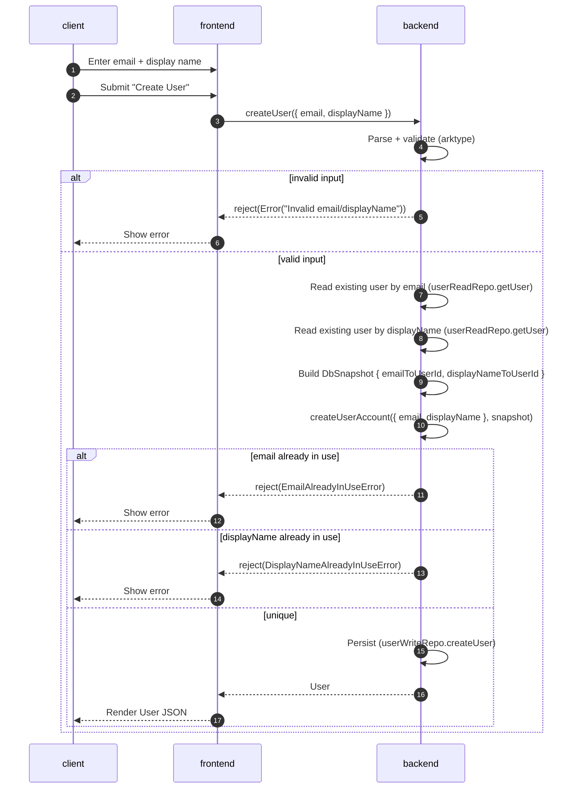
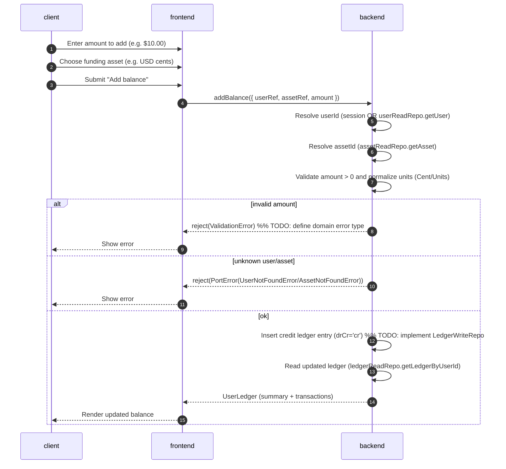
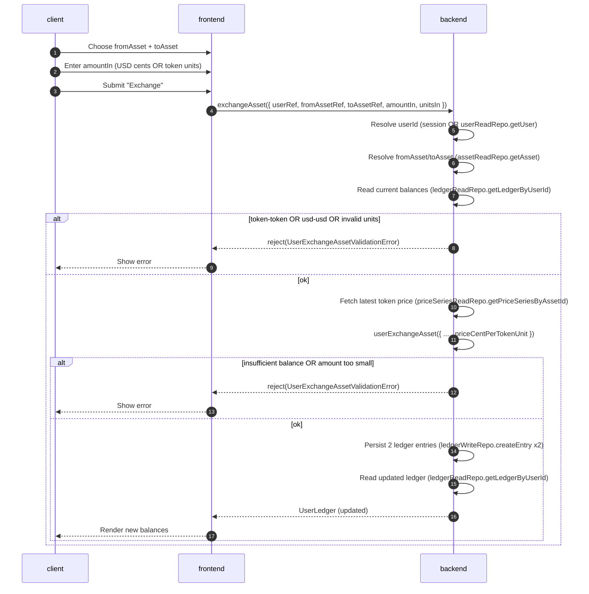

## Domain workflows (sequence diagrams)

This is documentation-only: it captures the workflows that exist today in the codebase, and the intended market-data workflows to build next, using Mermaid `sequenceDiagram`s.

### User: create user account (uniqueness validation)

Source: `domain/workflows/user.ts` (`createUserAccount`)

#### Files involved (and how they fit together)

- **client**
  - (Browser / end user; no code)
- **frontend**
  - `app/page.tsx` (client component; collects input + calls `createUser`)
  - `domain/aggregates/user.ts` (shared `User` type used for local state)
  - `domain/values/user.ts` (shared branded `UserEmail` / `UserDisplayName` used in inputs)
- **backend**
  - `lib/server/actions/create-user.ts` (server action; validates input, builds snapshot, runs workflow, persists user)
  - `domain/workflows/user.ts` (workflow logic: `createUserAccount`)
  - `domain/errors.ts` (domain errors: `EmailAlreadyInUseError`, `DisplayNameAlreadyInUseError`)
  - `domain/ports/user.ts` + `domain/ports/errors.ts` (repo interfaces + port error types)
  - `lib/server/ports/user.ts` (Drizzle-backed `userReadRepo` / `userWriteRepo`)
  - `lib/server/db.ts` + `lib/server/env.ts` (Db service + DATABASE_URL)
  - `lib/server/schema.ts` (Drizzle schema: `users` table)
  - `lib/shared/imports.ts` (Effect helpers: `E`, `Fn`, etc.)

### Ledger: user adds balance (credit entry) — intended

This flow is **not fully implemented yet**. The read side exists (ledger views + `ledgerReadRepo`), but the write side (creating `ledger_entries`) and UI/action wiring are missing.

#### Files involved (and how they fit together)

- **client**
  - (Browser / end user; no code)
- **frontend** (partially missing)
  - (Missing) UI + client code to capture amount/asset and call backend action
- **backend**
  - **Existing (read side)**:
    - `domain/aggregates/ledger.ts` (`UserLedger` aggregate shape)
    - `domain/values/currencies.ts` (`Cent`, `Dollar`, `Units`)
    - `domain/ports/ledger.ts` (`LedgerReadRepo`)
    - `lib/server/ports/ledger.ts` (`ledgerReadRepo` via `ledger_entries_with_balance`)
    - `lib/server/schema.ts` (`ledger_entries`, `ledger_summary_entries`, `ledger_entries_with_balance`)
    - `lib/server/ports/mapper.ts` (`ledgerEntryMapper.toDomain`)
  - **Likely needed for “add balance” (write side; missing)**:
    - (Missing) `domain/ports/ledger` write port (e.g. `LedgerWriteRepo.createEntry(...)`)
    - (Missing) backend action (e.g. `lib/server/actions/add-balance.ts`)
    - (Missing) infra repo to insert into `ledger_entries` (Drizzle insert)
    - `domain/ports/asset.ts` + `lib/server/ports/asset.ts` (to resolve the funding asset)
    - `domain/ports/user.ts` + `lib/server/ports/user.ts` (if resolving userId from a user reference)

### Exchange: user exchanges asset (token ⇄ USD)

Source: `domain/workflows/exchange.ts` (`userExchangeAsset`)

Domain constraint:

- Tokens can be exchanged with USD.
- Tokens **cannot** be exchanged with other tokens.

Exchange semantics:

- **Token → USD** is effectively a *sell* (debit token units, credit USD cents).
- **USD → Token** is effectively a *buy* (debit USD cents, credit token units).
- For USD → token, we treat the input as **max spend** and only debit the exact `spent` amount that converts at the given price; any `leftover` stays as USD balance.

