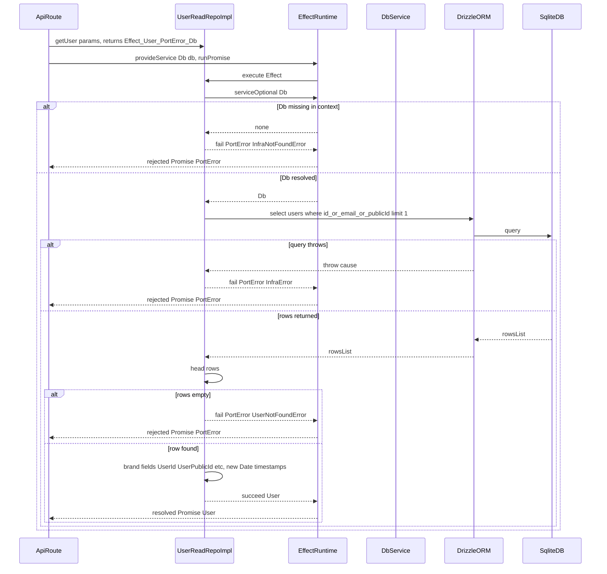
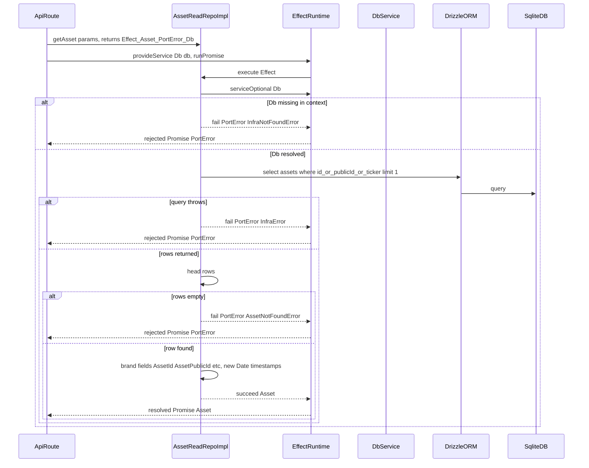
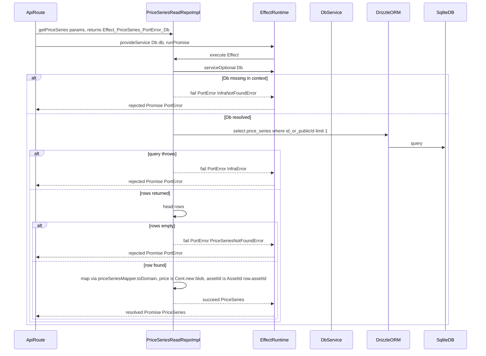
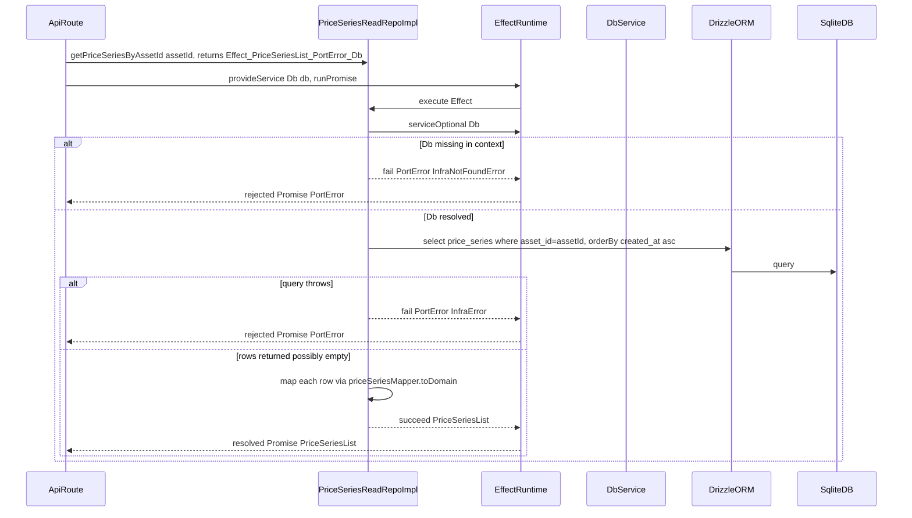
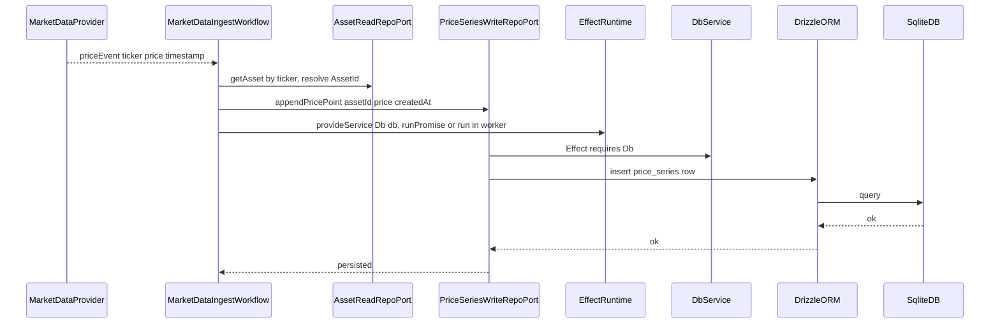
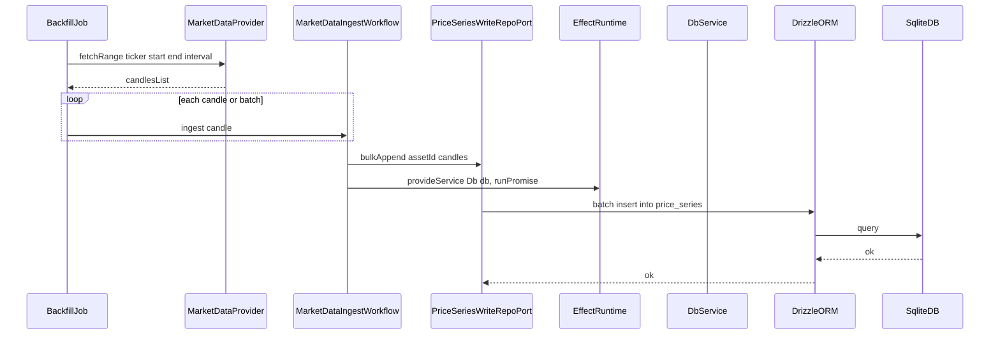
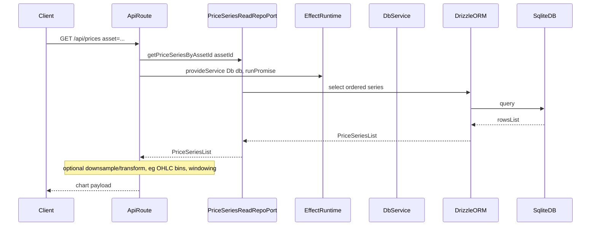
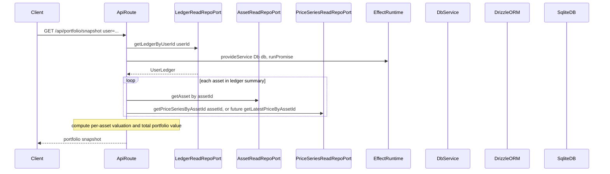
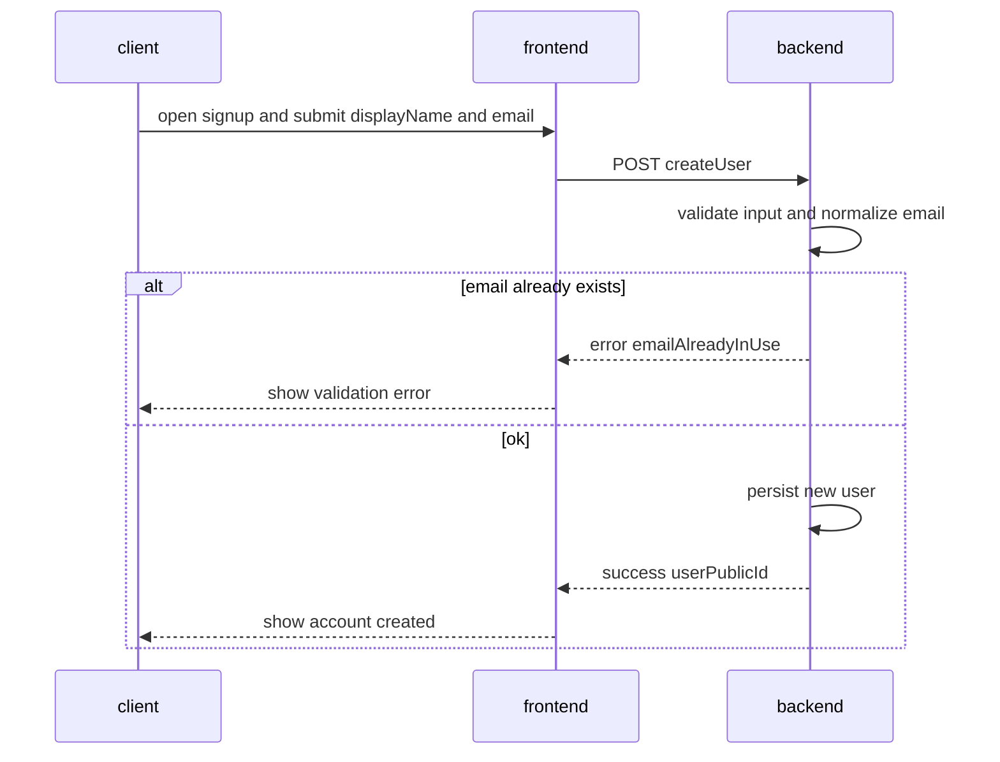
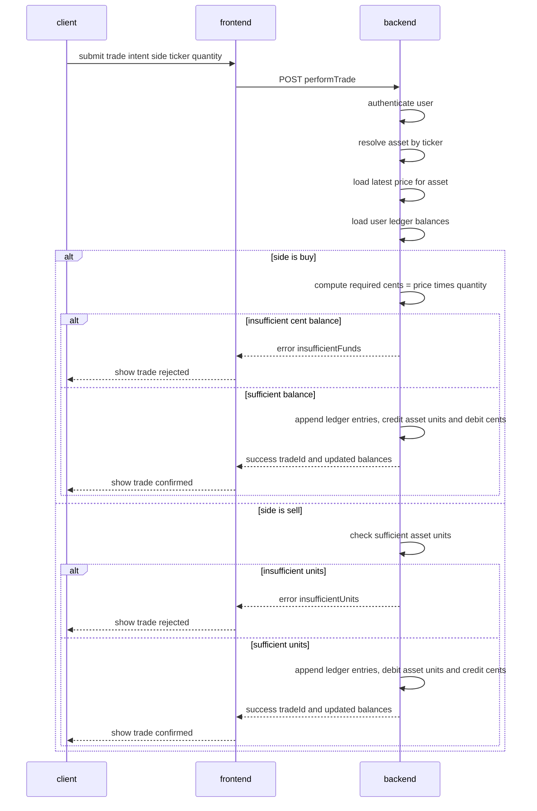

## Domain workflows (sequence diagrams)

This is documentation-only: it captures the workflows that exist today in the codebase, and the intended market-data workflows to build next, using Mermaid `sequenceDiagram`s.

## Implemented (grounded in code)

### GetUser

- Domain port: `domain/ports/user.ts` (`UserReadRepo.getUser`)
- Infra adapter: `lib/server/ports/user.ts` (`userReadRepo.getUser`)



### GetAsset

- Domain port: `domain/ports/asset.ts` (`AssetReadRepo.getAsset`)
- Infra adapter: `lib/server/ports/asset.ts` (`assetReadRepo.getAsset`)



### GetPriceSeries (single point by id/publicId)

- Domain port: `domain/ports/price-series.ts` (`PriceSeriesReadRepo.getPriceSeries`)
- Infra adapter: `lib/server/ports/price-series.ts` (`priceSeriesReadRepo.getPriceSeries`)



### GetPriceSeriesByAssetId (time-ordered series)

- Domain port: `domain/ports/price-series.ts` (`PriceSeriesReadRepo.getPriceSeriesByAssetId`)
- Infra adapter: `lib/server/ports/price-series.ts` (`priceSeriesReadRepo.getPriceSeriesByAssetId`)



### GetLedgerByUserId

- Domain port: `domain/ports/ledger.ts` (`LedgerReadRepo.getLedgerByUserId`)
- Infra adapter: `lib/server/ports/ledger.ts` (`ledgerReadRepo.getLedgerByUserId`)

```mermaid
sequenceDiagram
participant ApiRoute
participant LedgerReadRepoImpl
participant EffectRuntime
participant DbService
participant DrizzleORM
participant SqliteDB

ApiRoute->>LedgerReadRepoImpl: getLedgerByUserId userId, returns Effect_UserLedger_PortError_Db
ApiRoute->>EffectRuntime: provideService Db db, runPromise
EffectRuntime->>LedgerReadRepoImpl: execute Effect

LedgerReadRepoImpl->>EffectRuntime: serviceOptional Db
alt Db missing in context
  LedgerReadRepoImpl-->>EffectRuntime: fail PortError InfraNotFoundError
  EffectRuntime-->>ApiRoute: rejected Promise PortError
else Db resolved
  LedgerReadRepoImpl->>DrizzleORM: select from ledger_entries_with_balance view, where user_id=userId, orderBy created_at asc
  DrizzleORM->>SqliteDB: query
  alt query throws
    LedgerReadRepoImpl-->>EffectRuntime: fail PortError InfraError
    EffectRuntime-->>ApiRoute: rejected Promise PortError
  else rows returned
    Note over LedgerReadRepoImpl: Current mapper assumes at least 1 row; it reads rows0.userId
    alt rows empty
      LedgerReadRepoImpl-->>EffectRuntime: defect mapper throws in E.map
      EffectRuntime-->>ApiRoute: rejected Promise defect
    else rows non-empty
      LedgerReadRepoImpl->>LedgerReadRepoImpl: ledgerEntryMapper.toDomain rows; brands ids + Cent/Units based on units column
      LedgerReadRepoImpl-->>EffectRuntime: succeed UserLedger
      EffectRuntime-->>ApiRoute: resolved Promise UserLedger
    end
  end
end
```

## FUTURE (intended market-data workflows)

### IngestMarketPricePoint (single tick/candle)



### BackfillPriceSeries (historical range)



### ServePriceChart (client chart request)



### ComputePortfolioSnapshot (ledger + latest prices)



## FUTURE (account + trading workflows)

These diagrams describe the intended end-to-end flow across the three system entities you requested: `client`, `frontend`, `backend`.

### CreateUserAccount



### PerformTrade (buy or sell)


