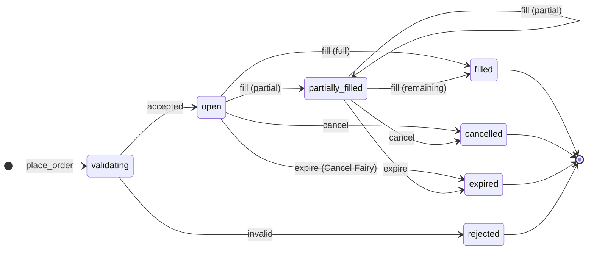

# Exchange Implementation Notes

## Current State: What's Done

| Layer | Component | Status |
|-------|-----------|--------|
| **Domain aggregates** | User, Asset, Ledger, PriceSeries, Exchange (MarketState, OrderBook, AmmPool, Order) | Done |
| **Branded values** | UserId, AssetId, Cent, Dollar, Units, OrderId, MarketSequenceNumber, Nonce | Done |
| **Domain errors** | All exchange + general errors | Done |
| **Domain ports** | UserRead/Write, AssetRead/Write, LedgerRead/Write, PriceSeriesRead, Mapper | Done |
| **Workflows** | `createUserAccount`, `creditUserBalance`, `processOrder` (matching engine + AMM swap) | Done |
| **Schema** | users, assets, price_series, ledger_entries, summary views | Done |
| **Infra ports** | user, asset, ledger, price-series repos + mappers | Done |
| **Server actions** | `createUser`, `addBalance` | Done |
| **Frontend** | Basic user creation + balance form | Done |

---

## What's Missing: The Full Gap Analysis

`processOrder` is pure logic that transforms one `MarketState` into another, but it's completely **disconnected** from persistence, the ledger, and the outside world.

---

### 1. Schema Additions (`lib/server/schema.ts`)

4 new tables needed:

#### `markets` table

Persists each trading pair and its current state:

- `id` (integer, PK)
- `public_id` (text, unique, uuid)
- `base_asset_id` (integer, FK → assets.id)
- `quote_asset_id` (integer, FK → assets.id)
- `sequence_number` (integer, default 0)
- `amm_reserve_base` (blob/bigint)
- `amm_reserve_quote` (blob/bigint)
- `status` (text, enum: `'active' | 'halted' | 'closed'`)
- `created_at`, `updated_at`

#### `orders` table

Persists every resting order on the book:

- `id` (integer, PK)
- `public_id` (text, unique, uuid)
- `market_id` (integer, FK → markets.id)
- `user_id` (integer, FK → users.id)
- `side` (text, enum: `'bid' | 'ask'`)
- `price` (blob/bigint)
- `quantity` (integer)
- `stop_loss` (blob/bigint)
- `market_sequence_number` (integer)
- `nonce` (integer)
- `status` (text, enum: `'open' | 'filled' | 'partially_filled' | 'cancelled' | 'expired'`)
- `created_at`, `updated_at`, `expires_at`

#### `fills` / `trades` table

Records each match:

- `id` (integer, PK)
- `market_id` (integer, FK → markets.id)
- `maker_order_id` (integer, FK → orders.id)
- `taker_order_id` (integer, FK → orders.id)
- `maker_user_id` (integer, FK → users.id)
- `taker_user_id` (integer, FK → users.id)
- `price` (blob/bigint)
- `quantity` (integer)
- `side` (text, enum: `'bid' | 'ask'`)
- `source` (text, enum: `'book' | 'amm'`)
- `created_at`

#### `market_events` table (optional, Phase 2 event-sourcing replay)

- `id` (integer, PK)
- `market_id` (integer, FK → markets.id)
- `sequence_number` (integer)
- `event_type` (text)
- `payload` (text/JSON blob)
- `created_at`

---

### 2. Ports to Add

#### `domain/ports/exchange.ts` (new file)

```typescript
// ExchangeReadRepo<D>
//   getMarketState(marketId): Effect<MarketState, PortError, D>
//   getOpenOrdersByUser(userId, marketId): Effect<Order[], PortError, D>
//   getOrderById(orderId): Effect<Order, PortError, D>

// ExchangeWriteRepo<D>
//   saveMarketState(state: MarketState): Effect<void, PortError, D>
//   insertOrder(order: Order): Effect<Order, PortError, D>
//   updateOrder(order: Order): Effect<void, PortError, D>
//   cancelOrder(orderId: OrderId): Effect<void, PortError, D>
//   insertFill(fill: Fill): Effect<void, PortError, D>
```

#### `domain/ports/price-series.ts` (add write)

```typescript
// PriceSeriesWriteRepo<D>
//   createPriceSeries(params): Effect<PriceSeries, PortError, D>
```

---

### 3. Aggregates / Values to Add

#### `domain/aggregates/exchange.ts` — add `Fill` type

```typescript
export type Fill = {
  id: string;
  marketId: number;
  makerOrderId: OrderId;
  takerOrderId: OrderId;
  makerUserId: UserId;
  takerUserId: UserId;
  price: Cent | Units;
  quantity: number;
  side: Side;
  source: 'book' | 'amm';
  createdAt: Date;
};
```

#### `domain/values/exchange.ts` — add `MarketId`

```typescript
export type MarketId = Brand.Branded<number, 'MarketId'>;
export const MarketId = Brand.nominal<MarketId>();
```

---

### 4. Workflows: What `processOrder` Doesn't Handle Yet

The matching engine is solid, but it's missing the **pre-trade** and **post-trade** steps. Either extend `processOrder` or wrap it in an orchestrating workflow.

#### Pre-trade checks (before calling `processOrder`)

- Validate the user has sufficient balance in the ledger
- Self-trade prevention (reject if taker would match against own resting order)
- Minimum order quantity / tick size enforcement

#### Post-trade settlement (after `processOrder` returns new `MarketState`)

- Diff the old vs new order book to extract fills
- For each fill: create **2 ledger entries** (debit buyer's USD, credit buyer's tokens; debit seller's tokens, credit seller's USD)
- Record each fill in the `fills` table
- Update the `orders` table (mark filled orders, update partial quantities)
- Persist the new `MarketState` (new AMM reserves, new sequence number)
- Insert a new price-series entry (last traded price)

#### Missing workflow functions

- `cancelOrder` — remove a resting order, return escrowed funds
- `createMarket` — initialize a new trading pair with seed AMM liquidity
- `provideLiquidity` / `removeLiquidity` — AMM liquidity management

---

### 5. Server Actions to Build

| Action file | What it does |
|-------------|-------------|
| `lib/server/actions/create-market.ts` | Creates market, seeds AMM pool, persists initial state |
| `lib/server/actions/place-order.ts` | Validates balance, runs `processOrder`, settles fills in ledger, persists new state |
| `lib/server/actions/cancel-order.ts` | Loads order, cancels it, returns escrowed funds to ledger |
| `lib/server/actions/create-asset.ts` | Creates a new tradable token (port exists, just no action) |

---

## Recommended Build Order

### Phase 1 — Schema + Exchange Ports (foundation)

1. Add `markets`, `orders`, `fills` tables to `lib/server/schema.ts`
2. Create `domain/ports/exchange.ts` (read + write interfaces)
3. Add to `domain/aggregates/exchange.ts` (`Fill` type) and `domain/values/exchange.ts` (`MarketId`)
4. Implement `lib/server/ports/exchange.ts` (Drizzle-backed repos)
5. Add exchange mapper to `lib/server/ports/mapper.ts`

### Phase 2 — Settlement Workflow (make processOrder useful)

6. Build a `settleOrder` or `executeOrder` workflow that wraps `processOrder` with:
   - Balance check (ledger read)
   - Call `processOrder`
   - Diff old/new state to extract fills
   - Create ledger entries for each fill
   - Persist fills + new market state
7. Add `PriceSeriesWriteRepo` and record last-trade price

### Phase 3 — Server Actions (connect to frontend)

8. `create-market.ts` action
9. `place-order.ts` action (the big one — orchestrates everything)
10. `cancel-order.ts` action

### Phase 4 — Background Logic (from state_machine.md)

11. Cancel fairy (expire stale orders)
12. Event log / snapshotting for deterministic replay

---

## Key Observation: `processOrder` Return Type

The matching engine returns `E.Effect<MarketState>` with fills "baked in" (quantities reduced on resting orders), but it **doesn't return the fills themselves**. Diffing order books to reconstruct fills is fragile. Change the return type to:

```typescript
type ProcessOrderResult = {
  newState: MarketState;
  fills: Fill[];
};
```

This makes ledger settlement straightforward — iterate over `fills` and create the corresponding debit/credit entries.

---

## Order Process Sketch (Stately / XState)

**Yes — Stately helps.** Use it in two ways:

1. **Sketching (design)** — [Stately Studio](https://state.new) lets you draw the order lifecycle as a statechart, share it, and refine it without code. The visual becomes the spec.
2. **Implementation** — [XState](https://xstate.js.org/) (v5) is the TypeScript library; you can export from Studio or hand-write a machine that matches the sketch. Same states and events in code.

Your `state_machine.md` already describes the exchange as a deterministic state machine; the **order** is one entity inside it with its own lifecycle. Stately is a good fit for sketching that lifecycle (states + events) and, if you want, driving UI or validation from it later.

### Order lifecycle (statechart sketch)

States align with the `orders.status` enum: `open | filled | partially_filled | cancelled | expired`. Events: user/system actions that move the order.



**Events (summary):**

| Event        | From           | To                | Who / when                    |
|-------------|----------------|-------------------|-------------------------------|
| `place_order` | (none)         | `validating`      | User submits order            |
| `accepted`    | `validating`   | `open`            | Pre-trade checks pass, on book |
| `invalid`     | `validating`   | `rejected`        | Balance / tick / self-trade   |
| `fill`        | `open` / `partially_filled` | same or `filled` | Matching engine / AMM        |
| `cancel`      | `open` / `partially_filled` | `cancelled` | User or API                   |
| `expire`      | `open` / `partially_filled` | `expired`  | Cancel Fairy (background)     |

You can drop this into [state.new](https://state.new), redraw it as an XState statechart, add guards (e.g. “only cancel if order is mine”), and optionally generate TypeScript from it. The Mermaid above is the sketch; Stately is where you refine and (if you want) implement it.

### Should the lifecycle be implemented in workflows?

**Yes.** The transition logic for each event should live in **workflows** (pure domain). That matches your existing pattern: workflows take input + optional snapshot, return `Effect<Result, Error>`, no I/O. Actions orchestrate: read via ports → call workflow → write via ports.

| Lifecycle transition | Where it's implemented |
|----------------------|------------------------|
| **place_order → validating** | Transient: we're "in" the place-order action. |
| **validating → accepted** | Workflow: validate (balance, self-trade, tick) + `processOrder`; returns `{ newState, fills }`. Action: persist order with status `open`, persist fills + ledger entries. |
| **validating → rejected** | Workflow fails with `InvalidOrderError` / `InsufficientBalanceError`; action returns error (no order row, or persist `rejected` for audit if you want). |
| **fill** (open → partially_filled / filled) | Inside `processOrder`: matching engine + AMM update quantities. Workflow returns fills; action updates `order.status` and writes ledger entries. |
| **cancel** (open / partially_filled → cancelled) | Workflow: `cancelOrder(order, marketState)` → new `MarketState` (order removed) + escrow to release. Action: persist state, create credit entry for user. |
| **expire** (→ expired) | Same `cancelOrder` workflow, invoked by Cancel Fairy (background) for orders past `expiresAt`. Action (or background job): persist. |

So you'll have workflows like:

- **`executeOrder`** (or a thin wrapper around `processOrder`) — handles place_order validation + matching; returns new state + fills. Used by place-order action.
- **`cancelOrder`** — removes order from book, returns new state + escrow amount. Used by cancel-order action and Cancel Fairy.
- **`processOrder`** (existing) — remains the core matching + AMM logic; optionally extended to return `fills` explicitly.

The **state** (`open`, `filled`, etc.) is either returned by the workflow and then persisted by the action, or read from the DB (`order.status`). You don't need XState in the backend for this; the sketch is the spec, workflows are the implementation. Use XState only if you want the same machine for UI (e.g. order form state) or for strict guards in one place.
