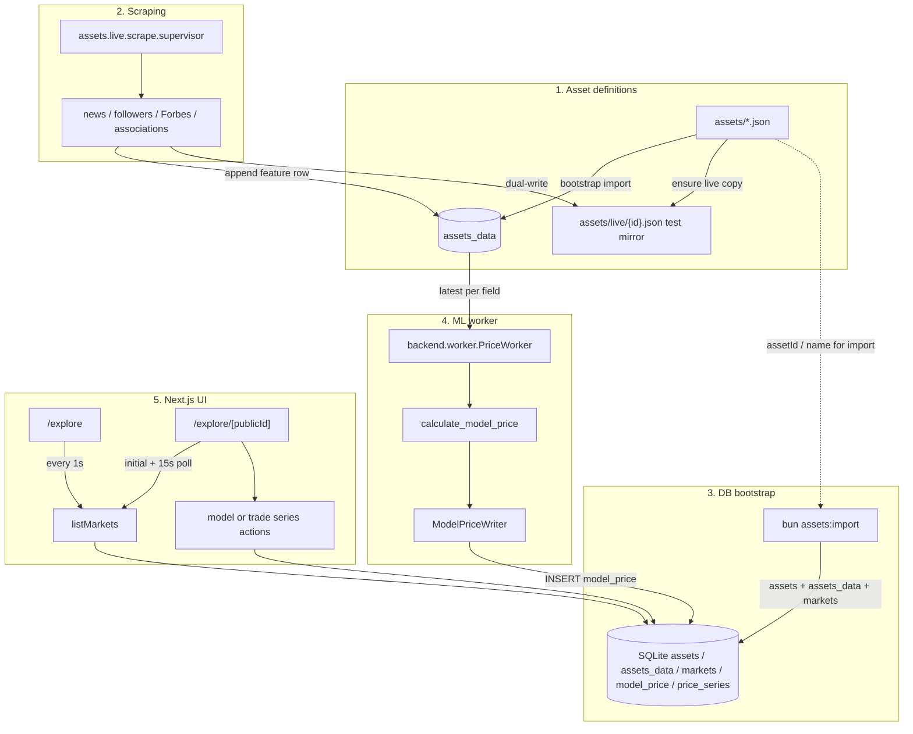

# Explore page data flow (scraped asset value -> UI)

This report maps how token asset facts move from canonical JSON and scraper updates into `assets_data`, through ML inference, SQLite, and Next.js server actions into the Explore list and market detail views.

---

## 1. End-to-end narrative

1. Canonical definitions live under `assets/*.json` (`kind: "token"`). These files define `assetId`, `name`, and baseline fields used by the ML feature schema.
2. `bun run assets:import` (`scripts/create-assets-from-json.ts`) upserts rows in SQLite `assets`, inserts missing initial `assets_data` rows for token features, creates a USD-quoted `markets` row per token (`status: closed` initially), and seeds `model_price` with zero so reads stay consistent.
3. The scrape supervisor (`uv run python -m assets.live.scrape`) runs periodic jobs (`news`, `followers_v2`, `scrapeForbes_v2`, `extended_associations_v2`) that append one `assets_data` row per updated feature and keep JSON mirrors at `assets/live/{assetId}.json` for testing.
4. The price worker (`uv run python -m backend.main` or `uv run bratva-worker`) reads the latest feature row per asset field from `assets_data`, normalizes samples, runs `calculate_model_price`, and writes directly to SQLite `model_price`.
5. The worker resolves each row as `assetTicker -> assets.ticker -> markets.base_asset_id`, stores the price using the same fixed-point blob encoding as `scaledBigintBlob`, and uses the tick timestamp as `created_at`.
6. Explore UI loads `listMarkets` (`lib/server/actions/list-markets.ts`), which chooses `displayPriceScaled`:
   - `closed` -> latest `model_price` for that market.
   - `pending` / `active` -> latest `price_series` for the base asset, else AMM ratio from reserves if non-zero, else `model_price` fallback.
7. Market detail (`app/explore/[publicId]/page.tsx`) uses the same `listMarkets` row for headline price context and loads `getMarketModelPriceSeries` or `getMarketPriceSeries` depending on `shouldUseModelPriceChart`.

---

## 2. Mermaid flowchart

---

## 3. Are the pieces plugged together?

### 3.1 What is wired correctly

| Link | Status |
|------|--------|
| Import -> `assets_data` | `assets:import` inserts missing initial feature rows from top-level `assets/*.json`. |
| Scrape -> `assets_data` | `update_live_field` appends one row per known feature update. |
| Scrape -> live JSON mirrors | Supervisors keep JSON mirrors for tests; locks prevent clobbering between scrapers. |
| `assets_data` -> ML features | Worker assembles latest feature values and requires the same field names as `InputData` / normalization (`backend/worker.py`). |
| Worker -> SQLite | `ModelPriceWriter` inserts directly into `model_price`, keyed by ticker -> market. |
| SQLite -> Explore list/detail | `listMarkets` and chart actions read through Effect ports (`marketReadRepo`, `priceSeriesReadRepo`). |
| Display price semantics | List page documents closed vs active/pending sources; chart helper `shouldUseModelPriceChart` mirrors that split. |

### 3.2 Loose ends and risks

1. **`assets_data` must be bootstrapped before the worker sees complete samples**  
   Run `bun run assets:import` after migrations. Re-running it backfills missing canonical feature rows without overwriting scraper history.

2. **Market resolution is first match**  
   The worker mirrors the existing TypeScript behavior by selecting one market for a base asset without forcing `quote_asset_id = USD`. Multiple markets per base asset could attach prices to the wrong row.

3. **One database URL must be shared**  
   Next, Drizzle, and the Python worker all need the same root `.env` `DATABASE_URL`.

4. **Remote libsql URLs are not supported by the Python writer**  
   The worker uses stdlib `sqlite3`, so `DATABASE_URL` must be a local SQLite file URL in this setup.

---

## 4. File index (quick reference)

| Stage | Primary locations |
|-------|-------------------|
| Canonical JSON | `assets/*.json` |
| Live mirrors | `assets/live/*.json`, `assets/live/scrape/*.py` |
| Import to DB | `scripts/create-assets-from-json.ts`, `lib/server/ports/assets-data.ts` |
| Feature persistence | `backend/persistence/assets_data.py`, `assets/live/scrape/common.py` |
| ML + SQLite write | `backend/worker.py`, `backend/persistence/model_price.py`, `backend/ml/price.py`, `backend/constants.py` |
| Env | `.env`, `lib/server/env.ts`, `backend/main.py` |
| Listing | `lib/server/actions/list-markets.ts`, `lib/server/ports/market.ts` |
| UI | `app/explore/page.tsx`, `app/explore/[publicId]/page.tsx`, `components/explore/market-price-chart.tsx` |

---

## 5. Bootstrap order

1. `bun run db:migrate`
2. `bun run assets:import`
3. `uv run python -m assets.live.scrape`
4. `uv run bratva-worker`

---

*Generated by tracing the Bratva repository (scraping -> worker -> SQLite -> Explore UI).*
