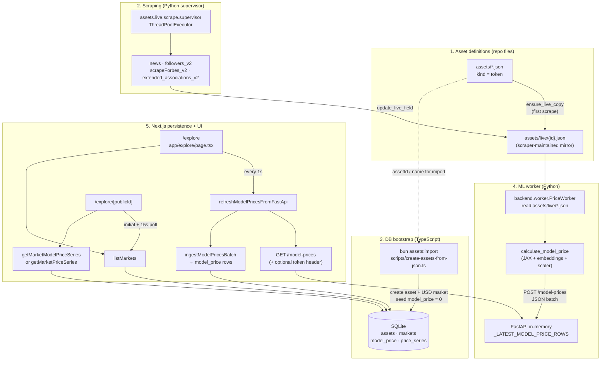

# Explore page data flow (scraped asset value → UI)

This report maps how **token asset facts** move from **scraped JSON mirrors** through **ML inference**, **FastAPI**, **SQLite**, and **Next.js server actions** into the **Explore** list and market detail views. It also records **integration gaps** found while tracing the code.

---

## 1. End-to-end narrative

1. **Canonical definitions** live under `assets/*.json` (`kind: "token"`). These files define `assetId`, `name`, and baseline fields used by the ML feature schema.
2. **`bun run assets:import`** (`scripts/create-assets-from-json.ts`) upserts rows in SQLite `assets`, creates a **USD-quoted** `markets` row per token (`status: closed` initially), and seeds `model_price` with **zero** so reads stay consistent.
3. **Scrape supervisor** (`uv run python -m assets.live.scrape`) runs periodic jobs (`news`, `followers_v2`, `scrapeForbes_v2`, `extended_associations_v2`) that read token definitions via `list_token_assets()` and write **live mirrors** at `assets/live/{assetId}.json` (`ensure_live_copy`, `update_live_field`). Cadence is configured in `assets/live/scrape/config.py`; state is stored in `assets/live/scrape/.last_run.json`.
4. **Price worker** (`uv run python -m backend.main` or `uv run bratva-worker`) reads **only** `assets/live/*.json` each tick (`PRICE_UPDATE_INTERVAL`, default 1s). It normalizes samples (including lowercasing `assetId`), runs **`calculate_model_price`** (`backend/ml/price.py`), and **POSTs** a batch to the local FastAPI **`POST /model-prices`** endpoint (`backend/worker.py`, `backend/api.py`). That endpoint holds the **latest batch in process memory** (not persisted).
5. **Next.js** persists model prices into SQLite: the **Explore index** (`app/explore/page.tsx`) every **1s** calls the server action **`refreshModelPricesFromFastApi`**, which **GETs** `FASTAPI_MODEL_PRICE_SOURCE_URL` (default `http://127.0.0.1:8010/model-prices`), parses rows, and **`ingestModelPricesBatch`** inserts into **`model_price`** keyed by resolving **`assetTicker` → `assets.ticker` → market via `base_asset_id`** (`lib/server/actions/ingest-model-prices.ts`, `lib/server/ports/market.ts`).
6. **Explore UI** loads **`listMarkets`** (`lib/server/actions/list-markets.ts`), which chooses **`displayPriceScaled`**:
   - **`closed`** → latest **`model_price`** for that market.
   - **`pending` / `active`** → latest **`price_series`** for the base asset, else AMM ratio from reserves if non-zero, else **`model_price`** fallback.
7. **Market detail** (`app/explore/[publicId]/page.tsx`) uses the same **`listMarkets`** row for headline price context, loads **`getMarketModelPriceSeries`** or **`getMarketPriceSeries`** depending on **`shouldUseModelPriceChart`** (aligned with list-markets’ closed vs trade semantics). Charts merge server series with a **client-side live tick buffer** (does not sample new ML values by itself).

---

## 2. Mermaid flowchart

---

## 3. Are the pieces plugged together?

### 3.1 What is wired correctly

| Link | Status |
|------|--------|
| Scrape → live JSON mirrors | Supervisors call `ensure_live_copy` / `update_live_field`; locks prevent clobbering between scrapers. |
| Live JSON → ML features | Worker requires the same field names as `InputData` / normalization (`backend/worker.py`). |
| Worker → FastAPI | POST URL from `FASTAPI_MODEL_PRICE_URL`; body matches `ModelPriceRow`. |
| FastAPI → SQLite | Explore index triggers GET + ingest; rows keyed by ticker → `base_asset_id` → `markets.id`. |
| SQLite → Explore list/detail | `listMarkets` and chart actions read through Effect ports (`marketReadRepo`, `priceSeriesReadRepo`). |
| Display price semantics | List page documents closed vs active/pending sources; chart helper **`shouldUseModelPriceChart`** mirrors that split. |

### 3.2 Loose ends and risks

1. **Persistence depends on the Explore index (or equivalent)**  
   **`refreshModelPricesFromFastApi`** is only referenced from **`app/explore/page.tsx`**. **`/explore/[publicId]`** never calls it. If a user opens a detail URL directly and nobody visits **`/explore`**, **`model_price`** in SQLite can lag indefinitely while the worker still updates FastAPI memory.

2. **`assets/live/*.json` must exist before the worker sees an asset**  
   The worker globs **`assets/live`** only. Imported DB assets without a scraped mirror are **invisible** to the worker until a scraper creates **`ensure_live_copy`**.

3. **POST `/model-prices` is unauthenticated**  
   **`backend/api.py`** validates **`x-model-price-token`** on **GET**, not on **POST**. The worker does not send a token on POST. If the API listens beyond localhost, ingestion is **trust-on-network**.

4. **Env token naming is split across stacks**  
   Python: **`FASTAPI_MODEL_PRICE_TOKEN`**. Next server: **`FASTAPI_MODEL_PRICE_SOURCE_TOKEN`**. They must match when the token is enabled, or GET fails with 401 while POST still accepts batches.

5. **`insertModelPrices` market resolution is “first match”**  
   For each `base_asset_id`, the repo selects **one** market with `.limit(1)` **without** forcing **`quote_asset_id = USD`**. Multiple markets per base asset could attach prices to the wrong row (unlikely if only USD pairs exist).

6. **Operational coupling**  
   Full fidelity requires **SQLite migrated**, **FastAPI**, **worker**, **scrape supervisor**, and **Next** (for DB ingest). **`npm run dev:all`** starts these four; dropping any leg breaks part of the chain (documented in root **`README.md`** with duplicate command variants).

7. **README command duplication**  
   **`README.md`** lists overlapping ways to start worker/API (`python -m` vs `bratva-worker` / `bratva-price-api`). **`pyproject.toml`** defines **`bratva-worker`** and **`bratva-price-api`** as the packaged scripts.

---

## 4. File index (quick reference)

| Stage | Primary locations |
|-------|-------------------|
| Canonical JSON | `assets/*.json` |
| Live mirrors | `assets/live/*.json`, `assets/live/scrape/*.py` |
| Import to DB | `scripts/create-assets-from-json.ts` |
| ML + bridge | `backend/worker.py`, `backend/ml/price.py`, `backend/api.py`, `backend/constants.py` |
| Env (Next server) | `lib/server/env.ts`, `lib/server/ports/model-price-feed.ts` |
| Ingest + listing | `lib/server/actions/ingest-model-prices.ts`, `lib/server/actions/list-markets.ts` |
| UI | `app/explore/page.tsx`, `app/explore/[publicId]/page.tsx`, `components/explore/market-price-chart.tsx` |

---

*Generated by tracing the Bratva repository (scraping → worker → FastAPI → Next ingest → Explore UI).*
