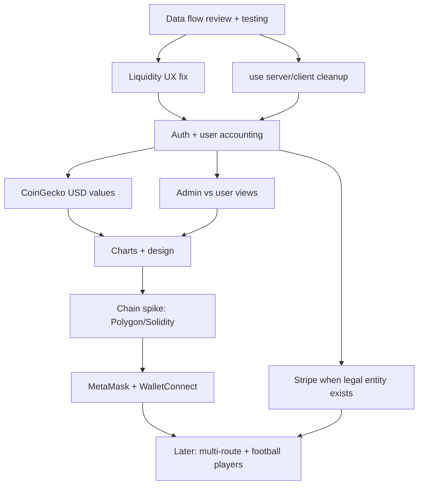

`Chain`
- Polygon / Solana --> probs polygon
    - look into solidity
- metamask
- walletconnect
- coingecko

`Stripe`
- needs legal entity

`frontend`
- charts improvement
- design
- Liquidity providing should not be shown as withdraw
- different views for admin and user

`overall`
- cleanup/testing
- take out use server/client
- pull USD value from coingecko
- user accounting
    - Practical checklist before production:
    - Set AUTH_SESSION_SECRET (e.g. 32+ random bytes) in production.
    - Add real authentication (password, magic link, OAuth, etc.).
    - Expose sign-out using clearSessionUser().
    - Keep admin checks in server layout/actions (as you do now); treat middleware as redirect-only.
    - Optionally shorten session TTL and add session tests.
- (Possibly) When migrating to order book pricing, allow users to attach comments to trades.
    - Display these comments on the graph at relevant points.
    - Enable sharing these annotated graphs as part of the whole experience.
- Can you migrate all state to zustand
- Max Networth pulling

`later release:`
- token to token in exchange (multi route trading)
- footbal players

---

## Proposed sequence

### Phase 1 — Stabilize the product you have (1–2 weeks)

Do this before new integrations or polish.

1. **Review `notes/explore-data-flow-report.md` and act on gaps**  
   Understand what is wired vs broken before changing charts, USD values, or auth. This de-risks everything else.

2. **Cleanup / testing (`overall`)**  
   Get domain tests and server actions green so later refactors do not regress silently.

3. **Liquidity UX fix: “provide” should not read as “withdraw” (`frontend`)**  
   Small, user-facing correctness fix on existing flows. Do it while you still have the liquidity code in context from testing.

4. **Remove ambiguous `use server` / `use client` boundaries (`overall`)**  
   Architectural cleanup is cheaper now than after wallet/Stripe/auth work spreads across more files.

---

### Phase 2 — Identity, roles, and accounting (before real users)

These are production prerequisites and should precede chain/Stripe.

5. **User accounting + auth checklist (`overall`)**, in this sub-order:
   - Set `AUTH_SESSION_SECRET` in prod config
   - Replace dev-only sign-in with real auth (password, magic link, or OAuth)
   - Expose sign-out via `clearSessionUser()` (you already have sign-in stubbed)
   - Keep admin checks in server layout/actions; middleware redirect-only
   - Optional: shorter session TTL + session tests

6. **Admin vs user views (`frontend`)**  
   Depends on auth/roles being real. Admin tooling (market ops, user support) should not ship on top of placeholder auth.

---

### Phase 3 — Display and UX polish (parallel-friendly)

Can overlap with Phase 2 once auth basics exist, but after core stability.

7. **Pull USD value from CoinGecko (`overall`)**  
   Independent of blockchain. Useful for charts, account balances, and explore pages. Do this before wallet work so USD display is settled off-chain first.

8. **Charts improvement (`frontend`)**  
   Better after CoinGecko USD wiring and after you have reviewed the explore data-flow report.

9. **Design pass (`frontend`)**  
   Last in the UI bucket so you are not redesigning screens that auth/admin/USD work will change.

---

### Phase 4 — Chain spike, then wallets (research → build)

Do not start wallet integration until the chain choice is made.

10. **Chain decision: Polygon vs Solana + Solidity research (`Chain`)**  
    Time-boxed spike: deployment model, gas, tooling, how it maps to your domain (orders, settlement, LP).

11. **MetaMask + WalletConnect (`Chain`)**  
    Only after step 10. Wallets connect to a chosen chain and contract model.

Note: CoinGecko appears under both `Chain` and `overall`. Treat it as **Phase 3 (off-chain USD)**; the chain work does not need to wait on it.

---

### Phase 5 — Payments (business-gated)

12. **Stripe (`Stripe`)**  
    Blocked on legal entity. You can draft requirements and pricing model in parallel, but implementation should wait until the entity exists. Stripe also assumes auth + user accounting from Phase 2.

---

### Phase 6 — Explicitly later

13. **Multi-route token-to-token exchange**
14. **Football players content/expansion**

---

## Dependency map

---

## What to defer or parallelize

| Do now | Parallel (non-blocking) | Wait |
|--------|-------------------------|------|
| Testing, data-flow gaps, liquidity label | CoinGecko API research | Stripe until legal entity |
| Auth hardening | Polygon vs Solana reading | Wallets until chain chosen |
| Admin/user split | Design exploration / mocks | Multi-route trading |

---

## Suggested first sprint (5–7 days)

1. Read explore data-flow report → fix any broken links it calls out
2. Run and fix failing tests
3. Fix liquidity “withdraw” copy/UX
4. Real auth + sign-out
5. Admin vs user route split

That gets you to a credible internal demo. CoinGecko USD and chain work come right after.

