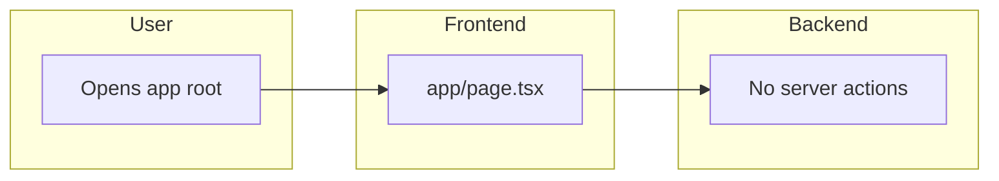
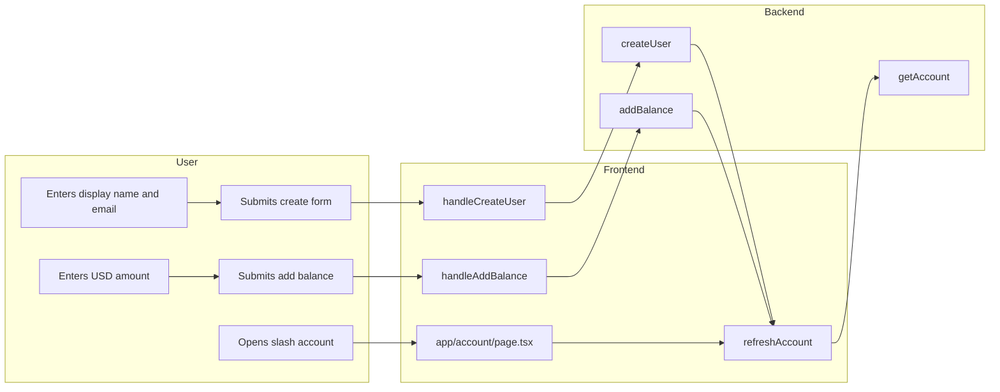
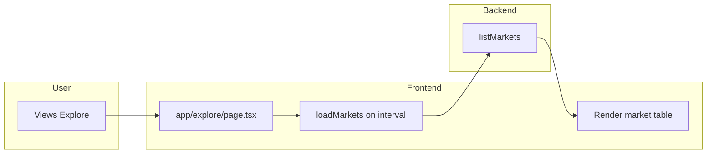
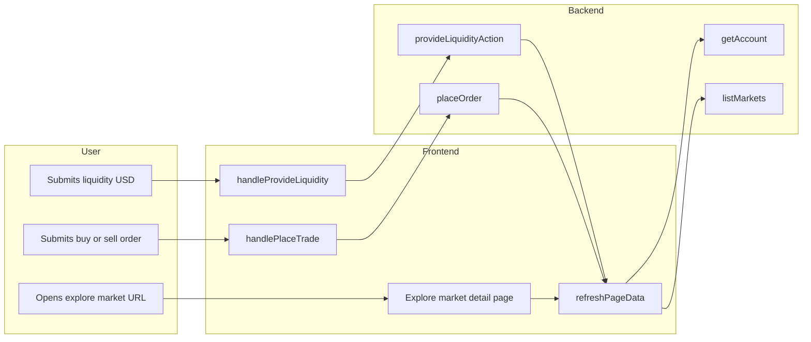

# Implemented user flows (UI → server actions)

Three-column layout: **User** → **Frontend** → **Backend**. Source of truth: `app/` pages and `lib/server/actions/`.

---

## Home

Static landing; no server actions.

---

## Account: create user, load snapshot, add balance

`getAccount` uses an implicit user (`getImplicitUser`); returns `null` if none.

---

## Explore index: market list

Poll interval ~1s (`REFRESH_INTERVAL_MS` in `app/explore/page.tsx`).

---

## Market detail: load, liquidity, trade

Client loads all markets then selects the row matching `publicId`.

---

## File reference

| Area | Page | Actions |
|------|------|---------|
| Home | `app/page.tsx` | — |
| Account | `app/account/page.tsx` | `createUser`, `getAccount`, `addBalance` |
| Explore | `app/explore/page.tsx` | `listMarkets` |
| Market | `app/explore/[publicId]/page.tsx` | `getAccount`, `listMarkets`, `provideLiquidityAction`, `placeOrder` |
