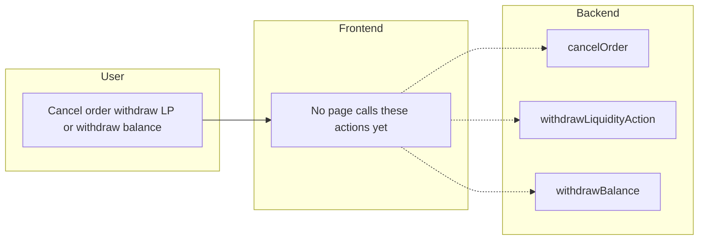
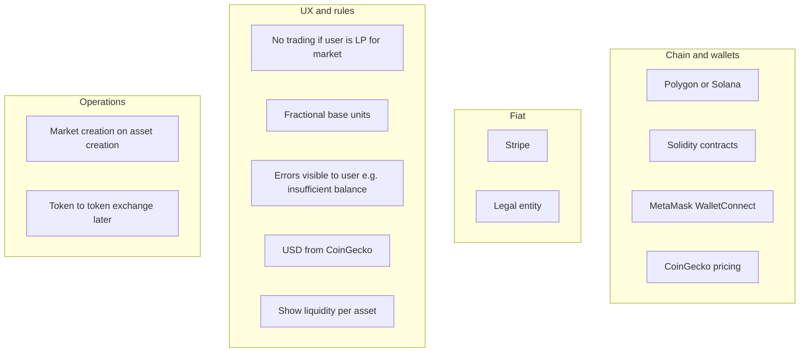
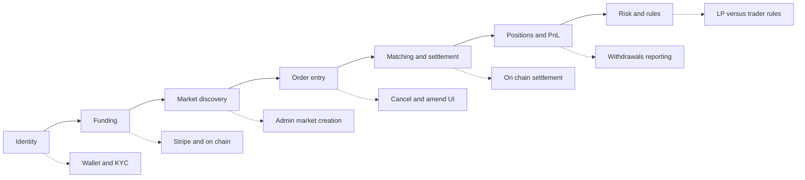

# Gaps toward a fully tradable market

Complements [implemented.md](./implemented.md): backend-only actions, UI gaps, and roadmap items (including `notes/next_steps.md`).

---

## Server actions not wired in the app

These exist under `lib/server/actions/` but have no `app/` caller yet.

| Action | Module |
|--------|--------|
| `cancelOrder` | `lib/server/actions/cancel-order.ts` |
| `withdrawLiquidityAction` | `lib/server/actions/withdraw-liquidity.ts` |
| `withdrawBalance` | `lib/server/actions/withdraw-balance.ts` |

---

## Product and infra roadmap (from notes)

---

## Target pipeline: identity to settlement

Solid arrows: main stages the codebase moves toward. Dashed arrows: gaps or partial work for a production-grade tradable market.

---

## Maintenance

When you add a server action under `app/`, update [implemented.md](./implemented.md). When `cancelOrder`, withdraw flows, or funding exits ship in the UI, move the corresponding edges from this file into `implemented.md`.
